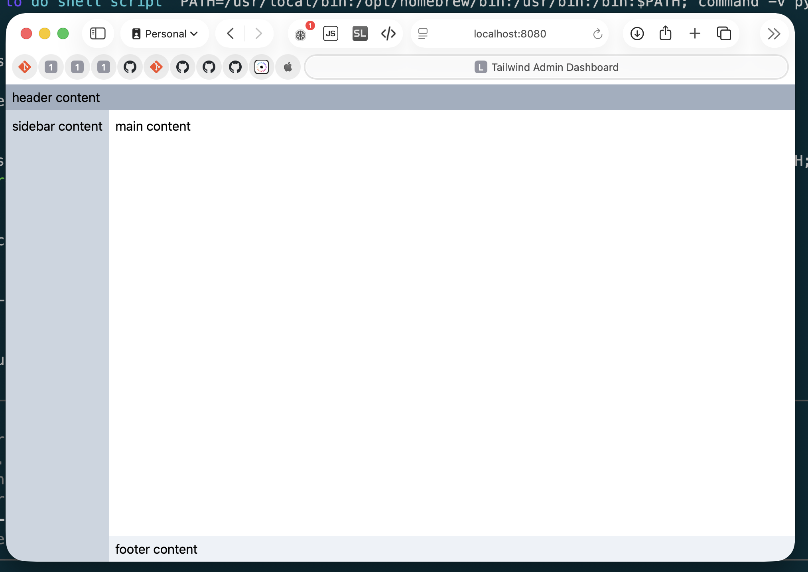

# Tailwind Admin Dashboard Droplet

A MacOS AppleScript droplet that now bundles **Kubo (IPFS)** and runs the
IPFS **WebUI** in its embedded browser. The bundled Tailwind Admin Dashboard
(`Contents/Resources/index.html`) remains available as a fallback.



## Usage (macOS)

1. Launch `dashboard.app` (or `dashboard-signed.app` after signing).
2. The bundled `ipfs` daemon starts (initializing
   `~/Library/Application Support/dashboard.app/ipfsrepo` on first run).
3. The IPFS WebUI opens in the droplet window at
   `http://127.0.0.1:5001/webui`.
4. Click **Stop Server** in the window to stop the daemon and quit.

Requirements: macOS with `python3` available on `PATH` and the bundled
`Contents/MacOS/ipfs` binary. The Python virtual environment in
`~/Library/Application Support/dashboard.app/.venv-browser` provides `PyQt6`
and `PyQt6-WebEngine`.

## Linux desktop entry

`.desktop` runs `serve-drop.sh`, which can serve a dropped file/folder or prompt
for one when launched directly.

Requirements: `zenity`, `python3`, and `nc`.

```bash
./serve-drop.sh /path/to/site-or-file.html
```

## Code signing (macOS)

```bash
./sign.sh
```

The script stages a clean bundle (only `Contents`) so dev files such as `.git`
do not break signing, signs it with your `Developer ID Application` identity, and
writes the result to `../dashboard-signed.app`.

## Release signing (macOS)

#### Generate an [App-Specific Passwords](https://account.apple.com/account/manage)

#### ***!!! After !!!*** [release.yml](https://github.com/RandyMcMillan/dashboard.app/blob/main/.github/workflows/release.yml) succeeds in publishing a tagged release...

####  [https://github.com/RandyMcMillan/dashboard.app/releases](https://github.com/RandyMcMillan/dashboard.app/releases)

###### run:

```
./Release.sh --notarize --password ####-####-####-####
```

## Project layout

```text
dashboard.app/
├── Contents/
│   ├── MacOS/
│   │   ├── droplet          # AppleScript applet executable
│   │   └── ipfs             # Bundled Kubo IPFS binary
│   ├── Resources/
│   │   ├── browser.py       # PyQt6 launcher + IPFS daemon management
│   │   ├── index.html       # Tailwind Admin Dashboard (fallback)
│   │   └── Scripts/main.scpt # Droplet logic
│   └── Info.plist
├── serve-drop.sh              # Linux/Unix helper
├── sign.sh                    # macOS signing helper
└── README.md
```
